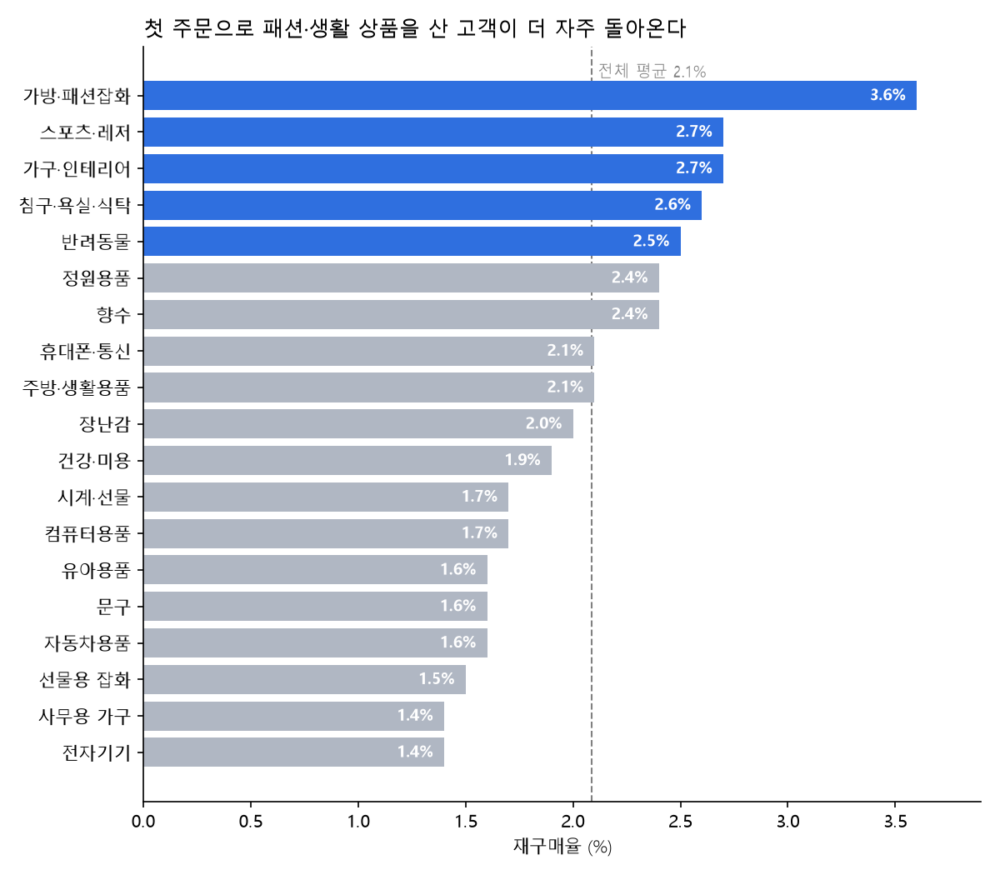
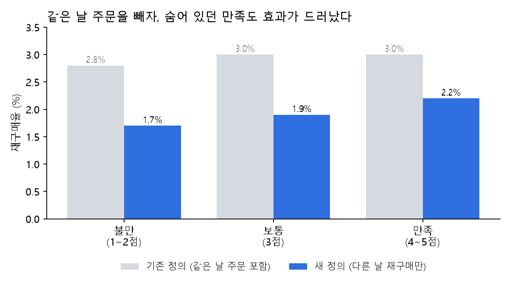
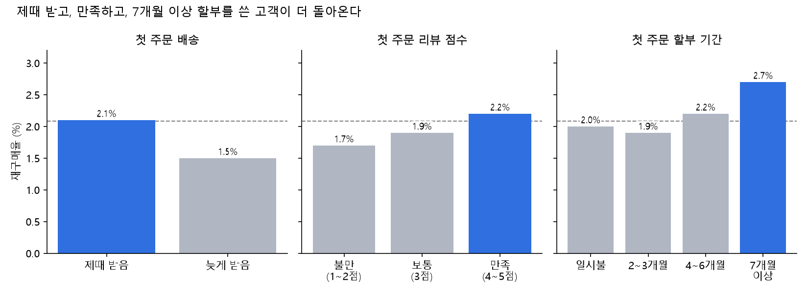

# 이커머스 재구매 분석: 다시 오는 고객은 첫 주문에서 무엇이 달랐나

브라질 이커머스 Olist의 실제 주문 데이터 약 10만 건으로, **재구매 고객이 첫 주문에서 무엇이 달랐는지** 분석한 프로젝트입니다.
분석 도중 재구매의 정의를 다시 세워야 하는 문제를 발견했고, 정의를 바꾸자 결론 일부가 달라졌습니다.

| 항목 | 내용 |
|---|---|
| 기간 | 2026.11 |
| 형태 | 개인 프로젝트 |
| 사용 기술 | Python (pandas, matplotlib, scipy), Jupyter Notebook |
| 데이터 | [Brazilian E-Commerce Public Dataset by Olist (Kaggle)](https://www.kaggle.com/datasets/olistbr/brazilian-ecommerce), 2016.09 ~ 2018.10 주문 99,441건 |

---

## 한눈에 보기

**문제**: 실제 고객 96,096명 중 두 번 이상 주문한 고객은 3.1%뿐이었습니다. 다시 오는 고객은 무엇이 다를까요?

**방법**: 고객마다 **첫 주문**만 골라, 그 주문의 특징(배송, 리뷰, 결제, 할부, 상품 카테고리)에 따라 재구매율을 비교했습니다.
재구매한 고객은 주문이 여러 번이라 그냥 비교하면 불공평하기 때문에, 모두의 **첫 주문 경험**을 같은 기준으로 비교했습니다.

**결과**

| 순위 | 첫 주문의 특징 | 재구매율 | 통계 검정 |
|---|---|---|---|
| 1 | 상품 카테고리 | 1.4% (전자기기) ~ 3.6% (가방·패션잡화) | p < 0.001 |
| 2 | 할부 기간 | 일시불 2.0% vs 7개월 이상 2.7% | p < 0.001 |
| 3 | 배송 지연 | 늦게 받음 1.5% vs 제때 받음 2.1% | p = 0.002 |
| 4 | 리뷰 점수 | 불만(1~2점) 1.7% vs 만족(4~5점) 2.2% | p < 0.001 |
| - | 결제 수단 | 차이가 있어 보였으나 확인되지 않음 | p = 0.065 |



---

## 1. 데이터 점검 (`01_explore.ipynb`)

분석 전에 데이터를 믿고 쓸 수 있는지부터 확인했습니다.

**주문 상태와 기간**
- 배송 완료 주문 96,478건 (전체의 약 97%)
- 배송 완료인데 도착 시각이 없는 주문 8건, 취소인데 도착 시각이 있는 주문 6건을 직접 찾아 확인
- 2016년은 월 주문이 0~324건으로 들쭉날쭉하고, 2018년 9월 이후는 20건 중 배송 완료가 0건이라 비정상 → 월별 추세는 2017.01 ~ 2018.08만 사용
- 2017년 11월이 유독 높은 이유: 11월 24일 블랙프라이데이 하루에 1,176건 (평소의 6~7배)

**테이블 구조에서 찾은 함정**

| 테이블 | 행 수 | 주의할 점 |
|---|---|---|
| orders | 99,441 | 기준 |
| customers | 99,441 | `customer_id`는 주문마다 새로 붙는 번호. 실제 사람은 `customer_unique_id` (96,096명) |
| items | 112,650 | 한 주문에 상품이 여러 개 |
| payments | 103,886 | 한 주문을 여러 수단으로 나눠 결제 (최대 29번, 모두 바우처) |
| reviews | 99,224 | 한 주문에 리뷰가 여러 개인 경우 있음 |

- `customer_id`로 재구매를 세면 모든 고객이 "한 번만 산 사람"으로 나와 완전히 틀린 결론이 나옵니다.
- 결제·리뷰를 주문과 그대로 합치면 주문이 중복으로 세어지므로, **주문 단위로 먼저 하나로 정리한 뒤** 붙였습니다.

## 2. 재구매 분석 (`02_repeat.ipynb`)

### 재구매 정의를 다시 세운 이유

처음에는 "배송 완료 주문이 2건 이상인 고객"을 재구매 고객으로 보고 분석했습니다 (2,801명, 3.0%).
그런데 두 번째 주문까지 걸린 기간을 확인해 보니, **재구매 고객의 30.5%(853명)가 첫 주문과 같은 날** 다시 주문했습니다.
이는 다시 온 것이 아니라 한 번에 살 것을 나눠 주문한 경우로 판단해, 정의를 바꿨습니다.

> **재구매 = 첫 주문과 다른 날(1일 이상 지나서) 두 번째 주문을 한 경우** (1,948명, 2.09%)

정의를 바꾸자 결론이 달라졌습니다.



- **리뷰 점수**: 기존 정의에서는 불만 2.8%, 만족 3.0%로 차이가 거의 없었지만, 새 정의에서는 불만 1.7% < 보통 1.9% < 만족 2.2%로 만족할수록 높아졌습니다. 같은 날 나눠 주문한 경우가 이 차이를 가리고 있었습니다.
- **할부**: 일시불 대비 7개월 이상 할부의 차이가 약 1.5배에서 약 1.35배로 줄었고, "할부가 길수록 높아진다"는 계단 모양이 깨졌습니다.
- 기존 정의 그대로였다면 **"만족도는 재구매와 상관없다"**는 틀린 결론을 냈을 것입니다.

### 요인별 결과



**상품 카테고리** (고객 1,000명 이상인 19개 카테고리)
- 가방·패션잡화 3.6%, 스포츠·레저 2.7%, 가구·인테리어 2.7%, 침구·욕실·식탁 2.6%가 높고
- 전자기기 1.4%, 사무용 가구 1.4%, 선물용 잡화 1.5%가 낮음
- 집 꾸미기·패션처럼 관련 상품을 이어서 사게 되는 카테고리는 높고, 선물이나 한 번 사면 오래 쓰는 상품은 낮음

**할부: 금액이 진짜 원인인지 확인**

할부를 길게 쓰는 건 보통 비싼 물건을 살 때라, 금액이 진짜 원인일 수 있습니다(교란 변수).
신용카드 고객만 골라 결제 금액을 저가·중가·고가로 나눠 같은 금액끼리 비교했습니다.

| 금액 \ 할부 | 일시불 | 2~3개월 | 4~6개월 | 7개월 이상 |
|---|---|---|---|---|
| 저가 | 1.8% | 2.5% | 2.8% | **4.0%** |
| 중가 | 2.0% | 1.5% | 2.0% | **3.1%** |
| 고가 | 1.9% | 1.9% | 1.9% | **2.4%** |

- 일시불끼리는 금액이 달라도 재구매율이 1.8~2.0%로 같음 → **금액은 원인이 아님**
- 7개월 이상 할부는 모든 금액 구간에서 가장 높음 → **장기 할부를 쓰는 소비 습관이 재구매와 관련**

**결제 수단**: 바우처로 첫 주문한 고객이 2.7%로 가장 높아 보였지만, 카이제곱 검정 p = 0.065로 우연일 수 있어 결론에서 제외했습니다.

### 통계 검정

카이제곱 검정으로 각 요인과 재구매 여부가 관련이 있는지 확인했습니다.
고객이 9만 명 이상이라 작은 차이도 유의하게 나올 수 있어, p-value와 함께 **차이의 크기**를 같이 봤습니다.

| 요인 | p-value | 판단 |
|---|---|---|
| 카테고리 | 4.2e-12 | 유의 |
| 할부 | 5.7e-05 | 유의 |
| 리뷰 점수 | 3.3e-04 | 유의 |
| 배송 지연 | 1.9e-03 | 유의 |
| 결제 수단 | 0.065 | 유의하지 않음 |

---

## 3. 제안

| 결과 | 제안 |
|---|---|
| 패션·인테리어·침구 첫 구매 고객의 재구매율이 높음 | 첫 주문 후 관련 상품 추천 |
| 장기 할부 고객의 재구매율이 높음 | 다음 구매 시 무이자 할부 혜택 (카드사 제휴) |
| 첫 주문 배송이 늦으면 재구매율이 약 30% 낮아짐 | 첫 주문 배송 예정일 준수 관리 |
| 첫 주문 만족도가 낮으면 재구매율이 낮음 | 리뷰 점수가 낮은 첫 주문 고객에게 사과 쿠폰 (효과는 실험으로 검증 필요) |

## 4. 한계

- **관계를 찾은 것이지 원인을 증명한 것은 아닙니다.** 예를 들어 "할부를 쓰게 하면 재구매가 늘어난다"고 단정할 수 없으며, 효과를 확인하려면 A/B 테스트가 필요합니다.
- 재구매율 자체가 2% 수준으로 매우 낮아, 가장 좋은 그룹도 대부분의 고객은 돌아오지 않습니다. 재구매가 낮은 근본 원인은 이 데이터로 알 수 없습니다.
- 데이터 기간이 짧아, 늦게 첫 주문한 고객은 다시 올 시간이 부족했습니다.
- 재구매 기준(다른 날 두 번째 주문)에 따라 숫자가 달라질 수 있습니다.

---

## 실행 방법

1. [Kaggle](https://www.kaggle.com/datasets/olistbr/brazilian-ecommerce)에서 데이터를 받아 `data/` 폴더에 CSV 파일을 넣습니다. (용량과 출처 표시를 위해 데이터는 저장소에 포함하지 않았습니다.)
2. 패키지 설치
   ```
   pip install -r requirements.txt
   ```
3. 노트북 실행
   ```
   python -m notebook
   ```
4. `01_explore.ipynb` → `02_repeat.ipynb` 순서로 위에서부터 실행합니다.

## 폴더 구조

```
olist-customer-analysis/
├── 01_explore.ipynb     # 데이터 점검: 주문 상태, 기간, 테이블 구조, 결제
├── 02_repeat.ipynb      # 재구매 분석: 첫 주문 특징별 비교, 정의 재검토, 통계 검정, 그래프
├── figures/             # 그래프 이미지
├── requirements.txt
└── data/                # Kaggle에서 받은 CSV (저장소에는 포함하지 않음)
```
